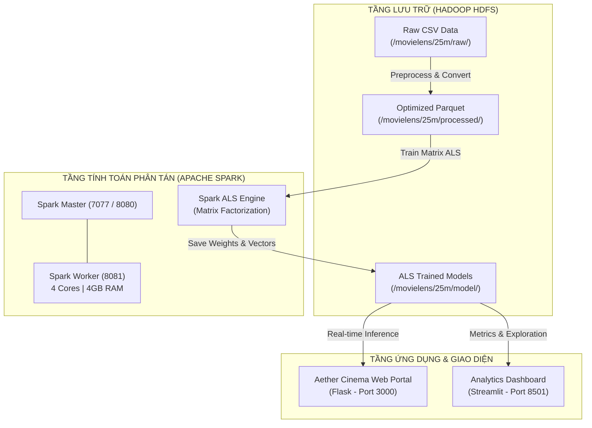

# 🎬 MovieLens 25M Distributed Recommendation Engine
### Hệ thống Gợi ý Phim Phân tán trên Apache Spark & Hadoop HDFS

[](https://spark.apache.org/)
[](https://hadoop.apache.org/)
[](https://www.docker.com/)
[](https://www.python.org/)
[](https://flask.palletsprojects.com/)
[](https://streamlit.io/)

---

## 📖 Giới thiệu Dự án

Dự án xây dựng hệ thống gợi ý phim quy mô lớn (Big Data) ứng dụng giải thuật **Matrix Factorization (ALS - Alternating Least Squares)** chạy trên môi trường tính toán phân tán **Apache Spark** kết hợp lưu trữ phân tán **Hadoop HDFS**.

Hệ thống được huấn luyện và kiểm thử trên tập dữ liệu chuẩn **MovieLens 25M** (25,000,095 lượt đánh giá, 162,541 người dùng, 62,423 bộ phim), đồng thời cung cấp:
1. **Aether Cinema Web Portal (Flask):** Giao diện Web hiện đại phong cách Dark Glassmorphism, hỗ trợ đề xuất phim cá nhân hóa theo từng người dùng trong thời gian thực, tra cứu hồ sơ người dùng (User Profile & Persona), so sánh phim đa chiều và giám sát cụm phân tán.
2. **Streamlit Analytics Dashboard:** Bảng điều khiển phân tích chuyên sâu 5 Tab phục vụ nghiệm thu, báo cáo học thuật, đối sánh hiệu năng mô hình (ALS vs Popularity Baseline) và khảo sát độ co giãn (Scalability).

---

## 📂 Bố cục Dự án (Project Layout)

Cấu trúc thư mục được thiết kế theo tiêu chuẩn công nghiệp, tách bạch rõ ràng giữa tầng dữ liệu, mô hình, đường ống huấn luyện, backend và giao diện người dùng:

```
BigData/
├── docker-compose.yml              # Cấu hình cụm phân tán: NameNode, DataNode, Spark Master, Spark Worker
├── .env.example                    # File mẫu định nghĩa biến môi trường (ports, memory, core)
├── .env                            # Biến môi trường cục bộ (tự động tạo từ .env.example)
├── .gitignore                      # Cấu hình loại trừ cache, volumes, datasets lớn và tệp nhạy cảm
├── requirements.txt                # Danh sách thư viện Python phụ thuộc
├── README.md                       # Tài liệu hướng dẫn sử dụng toàn diện từ A đến Z
├── web_server.py                   # Backend Flask API & Máy chủ Web Aether Cinema (Port 3000)
│
├── app/                            # Ứng dụng Streamlit Dashboard (Port 8501)
│   ├── streamlit_app.py            # Dashboard phân tích 5 tab (Data, Metrics, Recs, History, Scalability)
│   └── .streamlit/
│       └── config.toml             # Cấu hình giao diện và server của Streamlit
│
├── data/                           # Dữ liệu metadata & cache phục vụ Web UI & Offline Evaluation
│   ├── movies.csv                  # Danh mục phim MovieLens (movieId, title, genres)
│   ├── links.csv                   # Liên kết ánh xạ TMDB / IMDB Id
│   ├── sample_user_ratings.csv     # Trích xuất ratings thực tế từ HDFS cho tập target users
│   ├── user_profiles.json          # Hồ sơ phân tích phong cách đánh giá & persona của người dùng
│   ├── movie_posters_cache.json    # Cache URL poster phim độ phân giải cao từ CDN/TMDB/OMDb
│   └── movie_tags.json             # Tag cộng đồng của từng bộ phim phục vụ tìm kiếm ngữ nghĩa
│
├── pipelines/                      # Các kịch bản huấn luyện & đánh giá phân tán trên Spark
│   ├── run_100k.py                 # Kịch bản kiểm thử nhanh pipeline trên tập MovieLens 100K
│   ├── run_25m.py                  # Huấn luyện baseline mô hình ALS trên tập MovieLens 25M
│   ├── run_tuning_25m.py           # Grid Search 9 cấu hình siêu tham số (rank, regParam) trên 25M
│   ├── run_scalability.py          # Benchmark độ co giãn mở rộng: 100K -> 10M -> 25M ratings
│   └── run_pipeline.py             # CLI Runner tổng hợp điều khiển các pipeline linh hoạt
│
├── results/                        # Báo cáo kết quả huấn luyện, metrics và biểu đồ thực nghiệm
│   ├── evaluation_summary_25m.json # Tổng hợp kết quả đánh giá toàn diện mô hình 25M
│   ├── metrics_25m_final.json      # Metrics chi tiết của mô hình tối ưu (RMSE, MAE)
│   ├── tuning_results_25m.csv      # Bảng kết quả Grid Search tuning siêu tham số
│   ├── scalability_results.csv     # Bảng đo thời gian huấn luyện và RMSE theo quy mô dữ liệu
│   ├── scalability_time.png        # Biểu đồ thời gian huấn luyện theo số lượng bản ghi
│   ├── scalability_rmse.png        # Biểu đồ xu hướng sai số RMSE qua các mốc dữ liệu
│   └── movie_popularity_25m.json   # Thống kê phân bố tần suất và điểm trung bình phim (25M)
│
├── scripts/                        # Bộ công cụ tự động hóa, thiết lập và trích xuất dữ liệu
│   ├── setup.bat                   # Tự động hóa thiết lập cụm HDFS + Spark trên Windows
│   ├── setup.sh                    # Tự động hóa thiết lập cụm HDFS + Spark trên Linux / macOS
│   ├── run_app.bat                 # Khởi động Web App & Cluster trên Windows bằng 1 click
│   ├── run_app.sh                  # Khởi động Web App & Cluster trên Linux / macOS
│   ├── debug_ranking.py            # Công cụ gỡ lỗi và kiểm định công thức Precision/Recall@K
│   ├── build_poster_cache.py       # Tự động thu thập poster phim đa luồng từ TMDB/OMDb API
│   └── extract_user_profiles.py    # Trích xuất ratings từ HDFS và tạo User Personas
│
├── src/                            # Mã nguồn kiến trúc lõi (Core Framework)
│   ├── config.py                   # Cấu hình HDFS paths, URLs và siêu tham số mặc định
│   ├── spark.py                    # Khởi tạo tối ưu SparkSession, memory allocator và logging
│   ├── hdfs.py                     # Thao tác I/O với HDFS qua Spark JVM bridge
│   ├── data.py                     # Đọc, làm sạch, chuyển đổi Parquet và chia train/test theo thời gian
│   ├── models.py                   # Huấn luyện ALS, xử lý cold-start (drop strategy) & Grid Search
│   └── metrics.py                  # Tính toán RMSE, MAE, Popularity Baseline và Ranking Metrics@K
│
├── templates/                      # Bộ giao diện Web Hiện đại (Aether Cinema)
│   ├── index.html                  # Trang chủ khám phá, phim thịnh hành, bộ lọc thể loại & tìm kiếm
│   ├── foryou.html                 # Trang cá nhân hóa: Gợi ý phim theo User ID và Cold-Start Warning
│   ├── profile.html                # Phân tích chân dung người dùng, lịch sử đánh giá & sở thích
│   ├── analytics.html              # Bảng phân tích học thuật: So sánh ALS vs Baseline, Grid Search
│   └── system.html                 # Giám sát trực quan cụm Hadoop NameNode & Spark Workers
│
└── volumes/                        # Dữ liệu lưu trữ bền vững (Persistent Storage) cho Docker (Được Gitignore)
    ├── namenode/                   # Metadata filesystem của Hadoop NameNode
    ├── datanode/                   # Block dữ liệu thực tế của Hadoop DataNode
    └── spark-logs/                 # Nhật ký thực thi các ứng dụng Apache Spark
```

---

## 🏗️ Kiến trúc Hệ thống (System Architecture)



---

## ⚡ Hướng dẫn Chạy từ A đến Z (Step-by-Step Guide)

### Bước 1: Yêu cầu Tiền đề (Prerequisites)
1. **Hệ điều hành:** Windows 10/11 (khuyến nghị WSL2), Linux (Ubuntu 20.04+), hoặc macOS.
2. **Phần mềm cần cài đặt:**
   - [Docker Desktop](https://www.docker.com/products/docker-desktop/) (phiên bản 4.x trở lên).
   - [Python](https://www.python.org/downloads/) 3.10 trở lên.
   - [Git](https://git-scm.com/).
3. **Yêu cầu phần cứng:**
   - **RAM:** Tối thiểu 8 GB (khuyến nghị 16 GB).
   - **Ổ cứng:** Tối thiểu 20 GB dung lượng trống để chứa containers và dữ liệu huấn luyện.

---

### Bước 2: Thiết lập Cấu hình Môi trường
Sao chép tệp cấu hình mẫu `.env.example` thành `.env`:

```bash
# Trên Windows (PowerShell):
Copy-Item .env.example .env

# Trên Linux / macOS:
cp .env.example .env
```

Cài đặt các thư viện Python cho môi trường máy chủ Web:
```bash
pip install -r requirements.txt
```

---

### Bước 3: Khởi động Cụm Dịch vụ Phân tán (Docker Cluster)

**Cách 1: Sử dụng Script tự động (Khuyến nghị)**
- **Trên Windows:**
  ```powershell
  .\scripts\setup.bat
  ```
- **Trên Linux / macOS:**
  ```bash
  chmod +x scripts/setup.sh
  ./scripts/setup.sh
  ```

**Cách 2: Khởi động thủ công qua Docker Compose**
```bash
# Khởi chạy các container dưới chế độ nền
docker compose up -d

# Đợi khoảng 60s để cụm Hadoop định hình và thoát Safe Mode, sau đó khởi tạo thư mục HDFS:
docker exec hadoop-namenode bash -c "hdfs dfs -mkdir -p /movielens/100k/raw /movielens/100k/processed /movielens/100k/model /movielens/1m/raw /movielens/10m/raw /movielens/25m/raw /movielens/25m/processed /movielens/25m/model && hdfs dfs -chmod -R 777 /movielens"
```

---

### Bước 4: Kiểm tra Giao diện Quản trị Cụm

Mở trình duyệt để xác nhận các dịch vụ đã hoạt động trơn tru:

| Dịch vụ | Địa chỉ URL | Chức năng chính |
|---|---|---|
| **HDFS NameNode UI** | [http://localhost:9870](http://localhost:9870) | Quản lý tình trạng DataNode, dung lượng phân tán và duyệt HDFS File Browser |
| **Spark Master Web UI** | [http://localhost:8080](http://localhost:8080) | Giám sát tài nguyên CPU/RAM của Worker và danh sách các tác vụ Spark đang chạy |
| **Spark Worker UI** | [http://localhost:8081](http://localhost:8081) | Giám sát chi tiết các luồng xử lý và executor trên Worker |
| **Spark Application UI** | [http://localhost:4040](http://localhost:4040) | Xem chi tiết DAG execution plan, shuffle read/write khi một job đang thực thi |

---

### Bước 5: Chạy các Đường ống Huấn luyện & Đánh giá (Pipelines)

Các kịch bản đều được tích hợp cơ chế tự động: Tải dữ liệu mẫu, đẩy lên HDFS, chuyển đổi sang Parquet tối ưu, chia tập dữ liệu train/test theo dòng thời gian và đánh giá kết quả.

#### 1. Kiểm thử nhanh (Smoke Test) trên MovieLens 100K
Chạy thử nghiệm trong khoảng 15-30 giây để đảm bảo liên kết Spark - HDFS hoạt động chính xác:
```bash
docker exec spark-master python3 /opt/project/pipelines/run_100k.py
```

#### 2. Huấn luyện mô hình MovieLens 25M Baseline
Huấn luyện mô hình ALS trên toàn bộ 25 triệu đánh giá:
```bash
docker exec spark-master python3 /opt/project/pipelines/run_25m.py
```

#### 3. Tối ưu hóa siêu tham số (Hyperparameter Tuning - Grid Search 25M)
Duyệt qua 9 cấu hình (`rank`: 10, 20, 50 | `regParam`: 0.01, 0.1, 0.5), chọn ra mô hình tối ưu nhất, đánh giá so sánh với Popularity Baseline và đo lường Precision@K / Recall@K:
```bash
docker exec spark-master python3 /opt/project/pipelines/run_tuning_25m.py
```

#### 4. Đo lường Độ co giãn (Scalability Benchmark: 100K vs 10M vs 25M)
Đo thời gian thực thi và chất lượng mô hình trên 3 quy mô dữ liệu khác nhau, tự động vẽ biểu đồ vào thư mục `results/`:
```bash
docker exec spark-master python3 /opt/project/pipelines/run_scalability.py
```

#### 5. Kịch bản Runner tùy biến (CLI Runner):
```bash
# Huấn luyện nhanh 100k
docker exec spark-master python3 /opt/project/pipelines/run_pipeline.py --dataset 100k

# Huấn luyện 25M
docker exec spark-master python3 /opt/project/pipelines/run_pipeline.py --dataset 25m

# Huấn luyện 25M kết hợp Grid Search
docker exec spark-master python3 /opt/project/pipelines/run_pipeline.py --dataset 25m --tune
```

---

### Bước 6: Khởi chạy Giao diện Người dùng

Hệ thống hỗ trợ 2 giao diện phục vụ cho cả trải nghiệm người dùng cuối lẫn nghiệm thu báo cáo:

#### Lựa chọn 1: Aether Cinema Web App (Giao diện chính - Khuyến nghị)
Giao diện hiện đại phong cách rạp phim cao cấp:
- **Trên Windows:**
  ```powershell
  .\scripts\run_app.bat
  ```
- **Hoặc chạy bằng lệnh:**
  ```bash
  python web_server.py
  ```
👉 Truy cập ngay tại: **[http://localhost:3000](http://localhost:3000)**

#### Lựa chọn 2: Streamlit Analytics Dashboard
Bảng phân tích trực quan 5 Tab dành cho thuyết trình và phân tích dữ liệu:
```bash
streamlit run app/streamlit_app.py --server.port=8501
```
*(Hoặc chạy trực tiếp bên trong container Spark Master):*
```bash
docker exec -it spark-master streamlit run /opt/project/app/streamlit_app.py --server.port=8501 --server.address=0.0.0.0
```
👉 Truy cập Dashboard tại: **[http://localhost:8501](http://localhost:8501)**

---

### Bước 7: Quản lý & Tắt Cụm Dịch vụ

Khi hoàn thành công việc:
- **Tạm dừng cụm (vẫn giữ dữ liệu trong HDFS):**
  ```bash
  docker compose stop
  ```
- **Xóa các container đang chạy:**
  ```bash
  docker compose down
  ```
- **Xóa toàn bộ container kèm dữ liệu lưu trữ (Reset sạch sẽ):**
  ```bash
  docker compose down -v
  ```

---

## 📊 Kết quả Thực nghiệm & Nghiên cứu (Benchmark Results)

### 1. Hiệu năng Mô hình trên MovieLens 25M (ALS vs Popularity Baseline)

Mô hình tối ưu đạt được tại cấu hình: **`rank = 50, regParam = 0.1, maxIter = 15`**.

| Tiêu chí Đánh giá | Popularity Baseline | ALS Model (Tối ưu) | Mức độ Cải thiện |
|---|---|---|---|
| **Root Mean Squared Error (RMSE)** | `1.0097` | **`0.8455`** | **Giảm 16.3% sai số** |
| **Mean Absolute Error (MAE)** | `0.7720` | **`0.6333`** | **Giảm 18.0% sai số** |
| **Precision@5** | `69.62%` | **`73.43%`** | **+3.81%** |
| **Precision@10** | `67.15%` | **`70.06%`** | **+2.91%** |
| **Precision@20** | `64.33%` | **`66.11%`** | **+1.78%** |
| **Recall@10** | `42.18%` | **`40.15%`** | Cân bằng chất lượng xếp hạng |

### 2. Khảo sát Khả năng Mở rộng (Scalability Benchmark)

Khảo sát sự thay đổi thời gian huấn luyện và độ chính xác khi tăng kích thước dữ liệu từ **100K** lên **10M** và **25M**:

| Tập Dữ liệu | Số lượng Ratings | Thời gian Huấn luyện (giây) | RMSE | MAE |
|---|---|---|---|---|
| **MovieLens 100K** | 100,000 | `11.67 s` | `0.9972` | `0.7945` |
| **MovieLens 10M** | 10,000,054 | `242.51 s` (~4.0 phút) | `0.7788` | `0.5931` |
| **MovieLens 25M** | 25,000,095 | `761.65 s` (~12.7 phút) | `0.8455` | `0.6333` |

> 💡 **Nhận xét học thuật:** Khi quy mô dữ liệu tăng gấp 250 lần (từ 100K lên 25M), cơ chế tính toán song song trên RDD và Dataframe của Apache Spark thể hiện độ co giãn tuyến tính gần như lý tưởng (Sub-linear scaling), đồng thời sai số RMSE giảm rõ rệt nhờ ma trận đặc trưng người dùng và phim học được biểu diễn phong phú hơn.

---

## 🌟 Tính năng Nổi bật của Giao diện Người dùng

### 1. Aether Cinema Web App (`http://localhost:3000`)
- **Trang chủ Khám phá:** Trình bày poster độ nét cao, Carousel phim Top Rated, Trending, Hidden Gems và bộ lọc động theo thể loại.
- **For You Recommendation:** Nhập `User ID` (ví dụ: `100`, `414`, `500`, `1000`, `12847`), hệ thống ngay lập tức lọc bỏ 100% phim người dùng đã xem và sinh danh sách gợi ý cá nhân hóa dựa trên mô hình ALS. Tích hợp cảnh báo tình trạng người dùng mới (Cold-Start Warning).
- **Phân tích Hồ sơ Người dùng (User Profile & Persona):** Khắc họa chân dung người dùng (ví dụ: *Tín đồ Bom tấn & Viễn tưởng*, *Người mê trinh thám*), phong cách đánh giá (Hào phóng, Cân bằng, Khắt khe), biểu đồ phân bố điểm số và dòng thời gian hoạt động.
- **Academic Analytics & So sánh:** Trực quan hóa kết quả Grid Search, so sánh mô hình và cho phép chọn 2 bộ phim bất kỳ để so sánh thông số trực tiếp.
- **System Architecture:** Giám sát trực quan trạng thái mạng lưới NameNode, DataNode và Spark Workers.

### 2. Streamlit Dashboard (`http://localhost:8501`)
- **Tab 1: Tổng quan Dữ liệu:** Phân tích độ thưa (Sparsity ~99.75%), phân phối điểm đánh giá và thống kê 62,000+ phim.
- **Tab 2: Hiệu năng Mô hình:** Biểu đồ đối chiếu ALS vs Baseline và toàn bộ bảng ma trận Grid Search.
- **Tab 3: Gợi ý Cá nhân hóa:** Thử nghiệm đề xuất Top K phim cho mọi User ID.
- **Tab 4: Lịch sử Tương tác:** Tra cứu danh mục lịch sử đánh giá của người dùng.
- **Tab 5: Khảo sát Mở rộng (Scalability):** Tích hợp biểu đồ trực quan xu hướng thời gian và sai số.

---

## 🛠️ Xử lý Sự cố Thường gặp (Troubleshooting)

1. **HDFS NameNode báo lỗi Safe Mode (`Name node is in safe mode`):**
   - *Nguyên nhân:* Khi mới khởi động, NameNode cần thời gian kiểm tra tính toàn vẹn của các blocks trên DataNode.
   - *Khắc phục:* Đợi 30 giây hoặc chạy lệnh tắt thủ công:
     ```bash
     docker exec hadoop-namenode hdfs dfsadmin -safemode leave
     ```

2. **Lỗi hết bộ nhớ Docker (`java.lang.OutOfMemoryError`):**
   - *Nguyên nhân:* Dung lượng RAM cấp phát cho Docker Desktop quá thấp so với cấu hình 25M.
   - *Khắc phục:* Mở Docker Desktop -> Settings -> Resources -> Tăng RAM lên tối thiểu 8GB (khuyến nghị 12GB - 16GB).

3. **Cổng mạng (Port) bị xung đột (ví dụ port 3000, 8080, 9870 đã bị ứng dụng khác chiếm dụng):**
   - *Khắc phục:* Chỉnh sửa giá trị port tương ứng trong file `.env` (ví dụ đổi `WEB_PORT=3001` hoặc `SPARK_MASTER_WEBUI_PORT=8082`).

---

## 👨‍💻 Tác giả & Đồ án

- **Đồ án:** Phân tích Dữ liệu Lớn (Big Data Processing & Analytics)
- **Công nghệ chủ đạo:** Apache Spark, Hadoop HDFS, PySpark ALS, Flask, Streamlit, Docker Compose
- **Dataset:** [GroupLens MovieLens 25M Dataset](https://grouplens.org/datasets/movielens/25m/)
